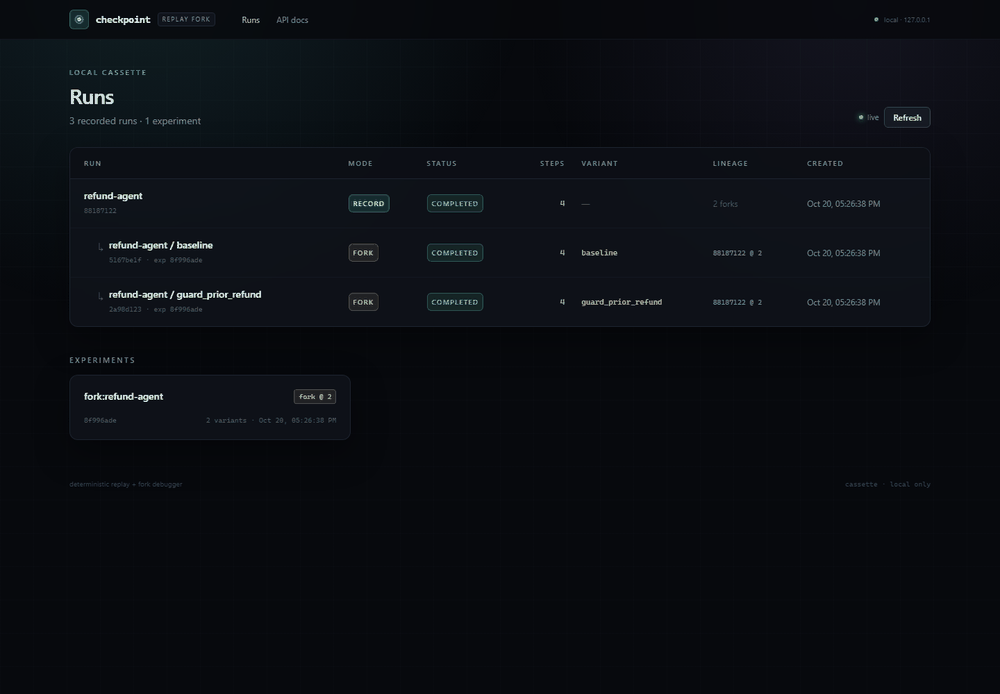

# checkpoint

**Deterministic replay and fork debugging for AI agents.**

Record a failed agent run once. Replay it without upstream calls. Fork at the
step where it went wrong, change the prompt, model, or code, and run several
variants against the same recorded prefix. Grade the branches with deterministic
checks, rubric judges, or swapped-order pairwise judges.

`checkpoint` is local-first: the daemon binds to `127.0.0.1`, cassettes are
SQLite files on your machine, and tests never need real API keys.



## Why

When an agent fails at step 8 of 10, testing a fix by re-running from step 1 is
slow, costs tokens, and may take a different path before reaching the failure.
`checkpoint` records every non-deterministic boundary, then lets you replay the
prefix and continue live from the fork point. The expensive, already-observed
part is served from the cassette.

## Honest scope: replay fork, not a process snapshot

A fork still re-executes the agent's local Python code from the beginning. What
it skips is every **boundary call** before the fork point: LLM calls, tool calls,
and checkpoint lookups are served from the cassette, so they make no upstream
calls and cost no tokens. This is called **replay fork**.

`checkpoint` does not restore a full in-memory process snapshot. Agent state must
be JSON-serializable if you want it recorded with `checkpoint.checkpoint()`.
`checkpoint.checkpoint()` is for state snapshots and Tier 1 before/after checks,
not for resuming a process.

## Quickstart

### Install the package

Requires Python 3.11+.

```bash
pip install checkpoint-ai
checkpoint web
```

Or run it without a persistent install:

```bash
uvx --from checkpoint-ai checkpoint web
```

The UI is served at <http://127.0.0.1:4040>. The default cassette is
`.checkpoint/cassettes.db` in the current directory.

If you are working on checkpoint itself, use a source checkout instead:

```bash
git clone https://github.com/ShivaKumarS-code/checkpoint.git
cd checkpoint/backend
uv sync
uv run checkpoint web
```

Node is only needed to rebuild the UI; the wheel includes the built `ui_dist`.

### Record, replay, and fork the demo agent

The bundled demo files are in the repository, not in the wheel. Clone the source
checkout first, then start the deterministic fake OpenAI-compatible provider in
one terminal. No API key is needed:

```bash
git clone https://github.com/ShivaKumarS-code/checkpoint.git
cd checkpoint/backend
uv run python -m examples.fake_llm
```

In a second terminal, from the repository root, record the refund agent:

```bash
cd backend
uv run checkpoint run \
  --upstream http://127.0.0.1:4141 \
  --name refund-agent \
  -- python examples/refund_agent/agent.py \
  "Please refund order ORD-1002. It arrived damaged."
```

The command prints the run id and its eight steps. Replay it:

```bash
uv run checkpoint replay <run_id> \
  python examples/refund_agent/agent.py \
  "Please refund order ORD-1002. It arrived damaged."
```

Local agent code runs again; the three LLM calls, four tools, and checkpoint are
served from the cassette. The replay is rejected with a readable diff if a
request before the fork point changes.

Fork the recording at step 5 and grade three variants:

```bash
uv run checkpoint fork <run_id> \
  --variants examples/refund_agent/variants.yaml
```

`baseline` and `cheaper_model` reproduce the duplicate-refund bug;
`guard_prior_refund` fixes it. `checkpoint fork` reports the conformance result.
For CI, use `checkpoint test`, which exits non-zero when a required check fails:

```bash
uv run checkpoint test examples/refund_agent/variants.yaml --run <run_id>
```

Open the experiment in the web UI to see the fork DAG and branch diff.

## How it works

```
agent process
  checkpoint.init() + @checkpoint.tool + @checkpoint.step + checkpoint.checkpoint()
  OpenAI/Anthropic-compatible HTTP
        |
        v
checkpoint daemon (FastAPI, 127.0.0.1 only)
  proxy: record / replay / fork, streaming, model and prompt overrides
  SDK RPC: tools, checkpoints, clock, UUIDs, random seeds
  query API + WebSocket + bundled UI
        |
        v
SQLite cassette (.checkpoint/cassettes.db)
  content-addressed, zstd-compressed blobs; runs, steps, experiments, verdicts
```

- **LLM calls** are recorded by the proxy. OpenAI-style
  `/v1/chat/completions` and Groq-style `/openai/v1/chat/completions` are
  supported, as is Anthropic `/v1/messages`, including SSE streaming.
- **Tool calls and checkpoints** are recorded by the Python SDK.
- **Step lookup** uses `(name, occurrence)` plus a normalized `match_key`, not a
  raw byte hash. Editing a later prompt does not invalidate the earlier prefix.
- **Before the fork point**, a mismatch is a loud `DIVERGED` result with a diff.
  **At or after the fork point**, calls go live.
- **Determinism** freezes the clock at each boundary and seeds UUIDs and
  `random` from the run seed. API keys and request headers are never stored;
  bodies are redacted before storage.

## Checks

### Tier 1: deterministic

`no_errors`, `tool_called`, `tool_not_called`, `tool_order`,
`final_output_matches` (regex or JSON schema), `state_equals`, `step_count_lte`,
and `python` (a custom function over the run's steps).

### Tier 2: rubric judge

A rubric check sends a materialized run view to an OpenAI-compatible small model
and stores a verdict. Judge calls are content-addressed and cached in SQLite.

```yaml
checks:
  - type: rubric
    name: helpfulness
    rubric: "The reply must name the order and explain the remedy."
    model: gpt-4o-mini
```

### Tier 3: swapped-order pairwise judge

A pairwise check compares each candidate variant against a reference run. The
judge sees the pair in both orders. A verdict is only accepted when the judge
selects the same run in both presentations; otherwise the verdict fails and
`position_consistent` is false.

```yaml
checks:
  - type: pairwise
    name: quality
    rubric: "Prefer the reply that is correct, specific, and safe."
    against: parent        # parent (default), a variant name, or a run id
    allow_tie: false       # ties pass only when true
    model: gpt-4o-mini
```

Directional judge calls are cached, so repeating the same pair does not make new
judge calls. The reference variant is skipped when it is itself in the
experiment. Tier 3 runs after all variants complete.

## Measured benchmark

Only measured numbers are reported here. The benchmark uses the deterministic
fake provider with a controlled **1,000 ms simulated latency per provider call**.
This is not real API latency, and the token counts are the fake provider's usage
counts, not billing data.

Method:

- Windows 11, Python 3.12.3.
- One warm-up record and replay per target, then **5 measured runs per mode**.
- `agent_ms` is wall time around agent execution, excluding interpreter startup.
- `process wall` is subprocess wall time including interpreter startup.
- Median values are shown; all samples are in the JSON files.
- Replay runs are verified to make **zero** provider calls.
- Replayed and semantic steps contribute zero upstream tokens.

| Target | Mode | Agent time (median) | Process wall (median) | Provider calls/run | Tokens/run |
|---|---|---:|---:|---:|---:|
| Refund demo (3 LLM calls) | live | 3,373.90 ms | 5,446.82 ms | 3 | 286 |
| Refund demo (3 LLM calls) | replay | 235.27 ms | 2,713.37 ms | 0 | 0 |
| DiffGuardian (2 LLM calls) | live | 2,595.72 ms | 11,870.10 ms | 2 | 736 |
| DiffGuardian (2 LLM calls) | replay | 398.93 ms | 7,333.01 ms | 0 | 0 |

Sample ranges (agent time): refund live 3,345.86–3,591.00 ms, replay
221.25–298.27 ms; DiffGuardian live 2,454.58–3,200.98 ms, replay
181.11–602.43 ms.

Raw data: [demo](backend/benchmarks/results-demo.json),
[DiffGuardian](backend/benchmarks/results-diffguardian.json).

Reproduce the demo measurement:

```bash
cd backend
uv run python benchmarks/benchmark.py --target demo --runs 5
```

For DiffGuardian, install its LangGraph/Groq dependencies into a separate
environment, then point the benchmark at it. The repository does not add those
dependencies to checkpoint:

```bash
cd backend
uv venv .venv-diffguardian
uv pip install --python .venv-diffguardian/bin/python -e . -r ../diffguardian/requirements.txt
DIFFGUARDIAN_ROOT=../diffguardian \
DIFFGUARDIAN_PYTHON="$PWD/.venv-diffguardian/bin/python" \
uv run python benchmarks/benchmark.py --target diffguardian --runs 5
```

On Windows, use
`.venv-diffguardian\Scripts\python.exe` and set the environment variables with
PowerShell. DiffGuardian is an optional external target; the demo target is
fully self-contained.

Replay is not instant because the agent's local code still runs, and every
replayed boundary still travels through the local proxy and SQLite. DiffGuardian
also pays a large one-time LangGraph import cost, which is included in process
wall time but excluded from `agent_ms`.

## Case study: DiffGuardian misses a SQL injection

The case study runs the real DiffGuardian LangGraph workflow against a fixture
diff containing SQL injection in `app/auth.py`. GitHub calls are replaced with
local fixtures, and the upstream model is the deterministic fake provider. The
workflow is real; the model is not.

- Parent recording: 2 provider calls, 736 tokens.
- Fork at step 1. The first LLM call is replayed from the cassette.
- `baseline` keeps the original review prompt and returns a generic approval
  that does not mention the vulnerability.
- `security_review` replaces the reviewer system prompt with an explicit
  security review. Its single post-fork LLM call reports the SQL injection and
  posts an inline comment at `app/auth.py:12`.
- Result: `baseline` fails `final_output_matches`, `security_review` passes.
- Post-fork provider calls: **2**, one per variant. The replayed prefix costs
  zero tokens.

Raw data: [case-study.json](backend/benchmarks/case-study.json). Reproduce with:

```bash
cd backend
DIFFGUARDIAN_ROOT=../diffguardian \
DIFFGUARDIAN_PYTHON="$PWD/.venv-diffguardian/bin/python" \
uv run python benchmarks/case_study_diffguardian.py
```

This case study demonstrates the replay-fork workflow on real agent code. It is
not a claim about DiffGuardian's behavior with a production model.

## Known limits

- **Sequential agents only.** Steps executed concurrently through
  `asyncio.gather` or threads do not have a deterministic arrival order.
- **JSON everywhere.** Tool inputs/outputs and checkpoint state must be
  serializable with msgspec. Custom serializers are available, but pickle and
  dill are never used.
- **Local code re-executes.** Replay fork only skips boundary calls. Slow local
  computation before the fork point is still slow.
- **Clock freezing changes time behavior.** Timeouts and elapsed-time logic see
  the frozen clock, advanced at each boundary.
- **Seeds are best effort.** `random` and UUIDs are handled; numpy, torch, and
  other libraries need user-supplied seed hooks.
- **Semantic matching can hide regressions.** It is opt-in per step name,
  disabled by default, and every hit is reported in the experiment summary.
- **Python SDK only.** The HTTP proxy works with LLM clients in other languages,
  but tool recording, clock freezing, and seed control require Python.
- **No full state hydration.** A fork starts a fresh process and re-executes
  local code; it does not resume a pickled interpreter.
- **Localhost only.** The daemon has no `0.0.0.0` mode.
- **Benchmark caveat.** The published timings use a deterministic fake provider
  and simulated latency. Re-measure against your own provider before making
  capacity or cost decisions.

## Development

Backend tests, lint, and types:

```bash
cd backend
uv sync
uv run pytest -q
uv run ruff check .
uv run pyright
```

Frontend build and Playwright smoke test:

```bash
cd frontend
npm ci
npm run build
npm run test:e2e
```

No real API keys are used by the test suite or the demo.
